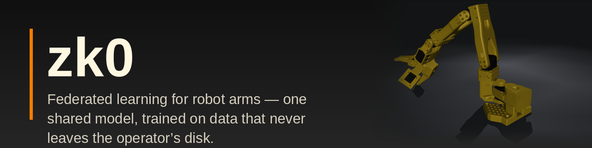
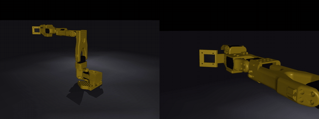
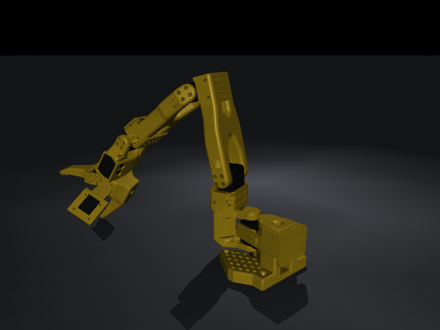
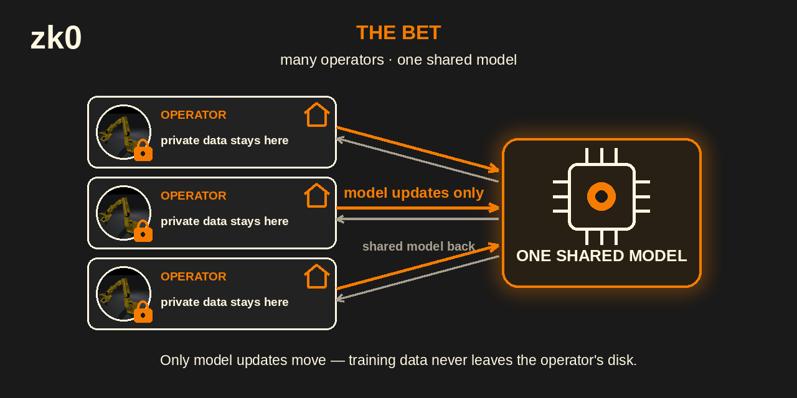

<p align="center">
  
</p>

<p align="center"><em>The bet: many operators, one shared model — only model updates move; data never leaves the operator’s disk.</em></p>

<p align="center">
  <a href="LICENSE"></a>
  <a href="https://huggingface.co/collections/zk0bot/zk0-simulation-assets"></a>
  <a href="https://discord.gg/dhMnEne7RP"></a>
  <a href="#quick-start"></a>
</p>

# zk0: Federated Learning for Robotics AI

Open-source federated learning platform for SmolVLA models on SO-100 datasets using Flower framework.

## Start here

| What | Where |
| --- | --- |
| 📦 **Simulation assets** | [zk0 Simulation Assets collection](https://huggingface.co/collections/zk0bot/zk0-simulation-assets) — free, open-licensed, verified |
| 🗂️ **Public asset homes** | Code and config live in this GitHub repo; simulation assets in the [zk0 Simulation Assets collection](https://huggingface.co/collections/zk0bot/zk0-simulation-assets); certified scenes and solutions in [zk0bot/sim-scene-solutions](https://huggingface.co/datasets/zk0bot/sim-scene-solutions); episode annotations in [zk0bot/certification-annotations](https://huggingface.co/datasets/zk0bot/certification-annotations); significant checkpoints in zk0bot model repositories; and the shipped model at [ivelin/zk0-smolvla-fl](https://huggingface.co/ivelin/zk0-smolvla-fl) |
| 🤖 **Model checkpoint** | [ivelin/zk0-smolvla-fl](https://huggingface.co/ivelin/zk0-smolvla-fl) |
| 🗺️ **Roadmap** | [zk0.bot/docs/ROADMAP.html](https://zk0.bot/docs/ROADMAP.html) |
| 💬 **Community** | [Discord](https://discord.gg/dhMnEne7RP) · [GitHub Discussions](https://github.com/ivelin/zk0/discussions) |
| 🦾 **Node operators** | [Become a node operator](#node-operators) |
| 🛠️ **For AI assistants** | [AGENTS.md](AGENTS.md) — the operating contract for assistants working on this repo |

## See it

<p align="center">
  
</p>

*The motion above is the SO-101 model’s joint range-of-motion sweep from the asset package — wide and gripper close-up views of the same recorded trajectory, rendered from the [zk0bot/so101-realistic](https://huggingface.co/zk0bot/so101-realistic) model files.*

<p align="center">
  
</p>

*The SO-101 arm model in reach pose — hero still from the same asset package.*

**Contents:** [Latest Model Release](#latest-model-release) · [Direction](#direction) · [Latest findings (Nov 2026)](#latest-findings-we-caught-our-own-simulator-lying-nov-2026) · [Simulation assets](#simulation-assets-on-hugging-face) · [Quick Start](#quick-start) · [Production Deployment](#production-deployment) · [Project Status](#project-status) · [Contributing](#contributing) · [Get involved](#get-involved)

## Latest Model Release

- **Model**: [ivelin/zk0-smolvla-fl](https://huggingface.co/ivelin/zk0-smolvla-fl)
- **Training**: Federated learning (Flower, FedProx) with the SmolVLA policy on SO-100 datasets. The run recorded in the model repository's own `metrics.json` (revision `b400eea`) covers **1 server round with 2 clients**.
- **Composite Eval Loss**: 0.15414857491850853 (1 evaluation dataset, 256 examples — from `metrics.json` in the model repository)
- **Framework**: Flower + SmolVLA + SO-100 datasets
- **Maintenance (2026-11-16)**: the checkpoint was repaired so it loads cleanly with current LeRobot. The published weights are unchanged — verified tensor-for-tensor against the original.

Load it with LeRobot (the checkpoint's `config.json` declares `"type": "smolvla"`; it is not a `transformers` `AutoModel` checkpoint):

```python
from lerobot.policies.smolvla import SmolVLAPolicy
from lerobot.policies.factory import make_pre_post_processors

policy = SmolVLAPolicy.from_pretrained("ivelin/zk0-smolvla-fl")
preprocessor, postprocessor = make_pre_post_processors(
    policy.config, pretrained_path="ivelin/zk0-smolvla-fl"
)
```

## Direction

zk0 trains **one shared model** across many independent robot-arm operators:

- Distributed operators train a shared SmolVLA-class model on their **private** LeRobot datasets. Only model updates move — training data never leaves the operator's machine.
- **Sim-first, with measured physics.** Simulation is our proving ground, but only when the physics is honest (see the audit below).
- **Provenance is never blurred.** Every result is marked for what it actually is: *sim-trained*, *sim-validated*, or *real-validated*.
- The current goal is concrete: the **first external node** running zk0 on data that never leaves its operator's disk.
- All node software is open source (Apache-2.0).

<p align="center">
  
</p>

*The bet, as a diagram: many operators, one shared model — only model updates move; training data never leaves the operator’s disk.*

Public roadmap: [zk0.bot/docs/ROADMAP.html](https://zk0.bot/docs/ROADMAP.html)

## Latest findings: we caught our own simulator lying (Nov 2026)

In November 2026 we audited the standard SO-101 simulation stack end-to-end — engines, arm model, object assets, and our own scoring code. The scoring code was the weakest link:

- **Final position is not grasp quality.** Our task scorer only checked where objects ended up. We built a grasp-quality gate that also measures the carry itself — object tilt, in-gripper slip, grip force relative to object weight, and actuator saturation. Re-scoring our recorded results under the gate **flipped 5 previously "passing" verdicts to FAIL**.
- **One "pass" was a physics exploit.** A mug grasp that scored as a success was being held by a ~47× body-weight stall clamp, squeezed through gripper contacts that a demo-tuned arm model ships with — finger friction that overrides the grasped object's own material. The real arm cannot do that; the score was fiction.
- **Engine scorecard.** On pre-registered, weighted criteria — scored by an independent verifier from the raw logs, not by the team that ran the tests — **MuJoCo ranked first of six engine configurations (82.6/100)**. Our working stack is MuJoCo + the Newton OpenUSD bridge + an open-licensed object shelf, probe-measured asset by asset before it enters a scene. Standing qualification: **a sim score is not evidence of real-world transfer**, and we never quote it as any.
- **An honest servo changes the answers.** We added a fitted STS3215 servo model (BAM) as a switchable profile: under load it sags 24.8–65.1 mm where the stock model sags under 1 mm, and grasps that "pass" under the stock servo fail under it. That is the point — evaluation should use the servo the hardware actually has.
- **Friction belongs to the object's coating, and clearance is a budget.** The same grasp strategy holds or sheds depending on the mug's surface class (glazed vs slippery vs rubbery), and one placement task flipped from fail to complete with 20 mm more clearance — while still failing the carry-quality gate. Both effects are now first-class fields in our asset database, not footnotes.

Full write-up: linked from [zk0.bot](https://zk0.bot). The assets in the next section are the ones these findings were measured on.

## Simulation assets on Hugging Face

Free, open-licensed, and verified the hard way — every asset below ships with its verification sheet, and this project's scenes load only from the collection:

**[zk0 Simulation Assets](https://huggingface.co/collections/zk0bot/zk0-simulation-assets)** (collection)

- **[zk0bot/so101-realistic](https://huggingface.co/zk0bot/so101-realistic)** — SO-101 arm realism variant, v0.2.0: de-tuned gripper contacts so the grasped object's material governs friction, a measured elbow joint limit, and the BAM fitted-servo profile as a switchable option. Apache-2.0.
- **[zk0bot/ycb-025-mug](https://huggingface.co/datasets/zk0bot/ycb-025-mug)** — the YCB mug, converted for simulation around its *measured* mass (0.118 kg — most object libraries guess), and probe-passed against our asset battery. CC BY 4.0.
- **[zk0bot/triposg-mug](https://huggingface.co/datasets/zk0bot/triposg-mug)** — a generated mug, and the collection's one **sealed** asset: its files are hash-stamped against the exact test record that validated them, so anyone can check the proof instead of re-running it. CC BY 4.0.
- **[ivelin/zk0-smolvla-fl](https://huggingface.co/ivelin/zk0-smolvla-fl)** — the federated SmolVLA checkpoint (see Latest Model Release).

## Quick Start

For detailed setup, see [docs/INSTALLATION](docs/INSTALLATION).

### Prerequisites

- Python 3.10+, Conda, Git.
- NVIDIA GPU recommended.

### Clone and Setup

```shell
git clone https://github.com/ivelin/zk0.git
cd zk0

# Create conda env
conda create -n zk0 python=3.10 -y
conda activate zk0
conda install ffmpeg=7.1.1 -c conda-forge

# Install deps
pip install -e .

# Env vars
cp .env.example .env  # Edit as needed (e.g., HF_TOKEN)
```

### Run the Simulation

See [docs/INSTALLATION](docs/INSTALLATION) for full instructions.

```bash
# Tiny test run (1 round)
./train-fl-simulation.sh --tiny

```

## Production Deployment

For production use with multiple distributed nodes, use the zk0bot CLI tool for orchestrated federated learning:

```bash
# Server operator: Start the central coordinator
zk0bot server start

# Client operators (each with their private dataset)
zk0bot client start hf:yourusername/your-private-dataset
# or
zk0bot client start local:/path/to/your/dataset

# Monitor status
zk0bot status

# Stop services
zk0bot server stop
zk0bot client stop
```

The CLI uses Flower's Deployment Engine (SuperLink, SuperNodes, SuperExec) for stateless, insecure-mode operation. Server runs continuously, automatically managing FL sessions based on connected clients. See [docs/NODE-OPERATORS.md](docs/NODE-OPERATORS.md) for detailed setup and security notes.

For run details, outputs, experiment tracking, and model pushing, see [docs/RUNNING](docs/RUNNING). For repository branches and contributing guidelines, see [CONTRIBUTING](CONTRIBUTING).

## Project Status

### Current Stage: Beta

The project is ready for local simulation testing with multiple clients and datasets.

#### In Progress
- Preparing client and server modules for production deployment
- Recruiting the first external node operators — see Contributing below
- Simulation validation program: measured-physics assets and honest evaluation gates — see Latest findings above
- Longer-term research: selective ZK techniques (aggregator and norm proofs); transparency-log provenance

**Config**: 12 clients available (4 active); 500 rounds; policy loss metric; FedProx (μ=0.01); server-side evaluation.

For full details, see [docs/ARCHITECTURE](docs/ARCHITECTURE#project-status).


## Contributing

We welcome contributions from the community! At this Beta stage, we're particularly interested in:

### Node Operators

#### Requirements

- **Hardware**: LeRobot SO100 or SO101 robotic arm. Contributors can either:
  - Build a DIY arm using the official [LeRobot SO101 repository](https://huggingface.co/docs/lerobot/so101)
  - Or order a pre-built kit, for example [this one](https://www.ebay.com/str/ovobot) from Florin who runs the [Austin Robotics Meetup](https://austinrobotics.io/).
- **Compute**: Local machine with RTX 3090 GPU or better, compatible with LeRobot library
- **Network**: Stable internet connection for federated communication
- **Data**: Unique training data from your robotics setup

If you meet these requirements, we'd love for you to join as a node operator. Your unique training data and compute resources will help improve the federated learning system. For detailed setup instructions, see [CONTRIBUTING](CONTRIBUTING).

### Other Ways to Contribute

There are several ways you can contribute to this project:

1. **Node Operators**: Join the federated network with your hardware and data
2. **Code Contributors**: Improve the codebase, add features, fix bugs
3. **Documentation**: Help improve documentation and tutorials
4. **Testing**: Report bugs, test new features, improve test coverage
5. **Feedback**: Share your experience and suggestions

For more details on each, see [CONTRIBUTING](CONTRIBUTING).

### Working with AI assistants

Day-to-day work on this repo — setup, upkeep, deployment, issue triage, and PR preparation — is done by AI assistants working under the maintainer's supervision, the same way zk0 node operators will work with their own bots. Assistants can prepare a change end to end, but merges, releases, and public claims stay human-approved, and whoever builds a change never certifies it: every PR carries its verification evidence. The operating contract for assistants is [AGENTS.md](AGENTS.md) — humans directing an assistant should point it there first.

## Get involved

- **Try the assets** — everything in the [zk0 Simulation Assets collection](https://huggingface.co/collections/zk0bot/zk0-simulation-assets) is free and open-licensed. Download a mug, stress our physics, tell us what you find.
- **Star / watch this repo** — follow along as verified results and releases land.
- **Join the community** — [Discord](https://discord.gg/dhMnEne7RP) for operators and builders; [GitHub Discussions](https://github.com/ivelin/zk0/discussions) for longer-form questions.
- **Own an SO-100/SO-101 arm?** zk0 is recruiting its **first external node operators** — the milestone this whole project is pointed at. Start with the [node-operator application](https://github.com/ivelin/zk0/issues/new/choose) or say hello in Discord.

zk0 is a project of CocoonHive LLC dba zk0.
