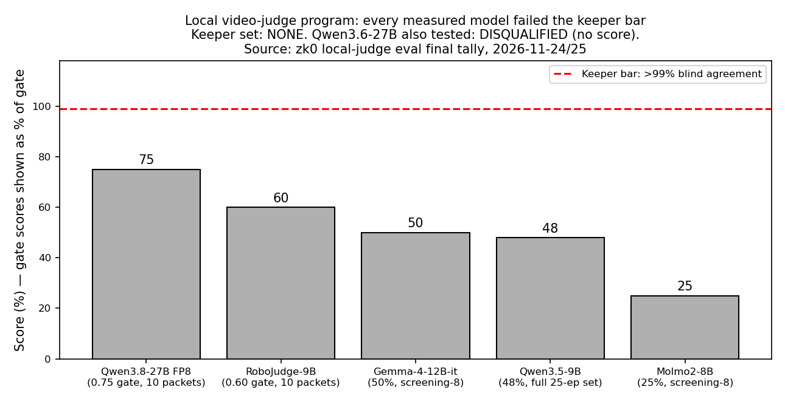
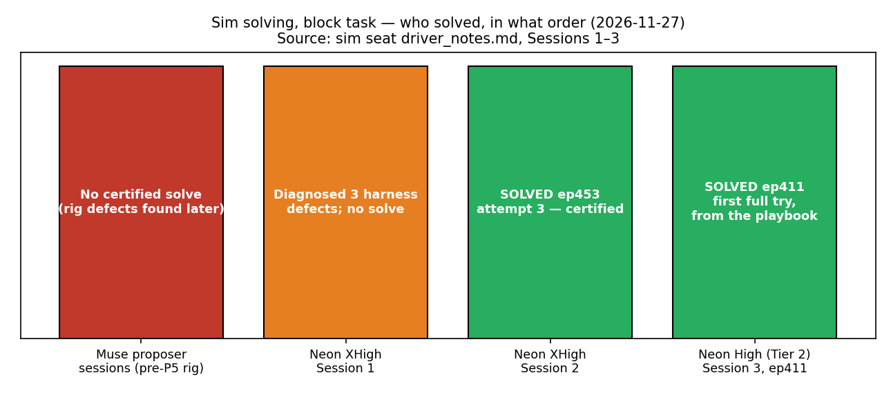
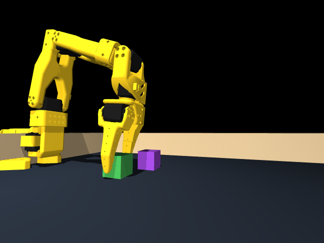
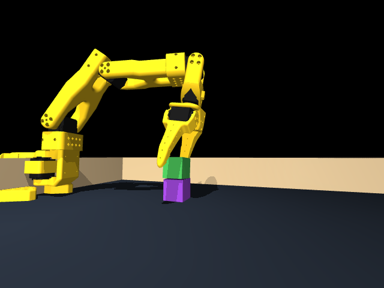
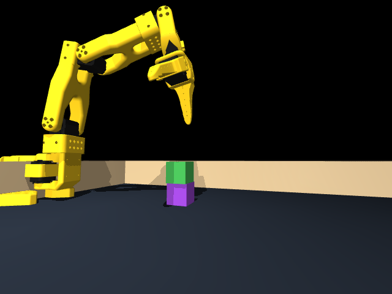

# Frontier Models Became Robot Teachers

## What I learned judging, solving, and teaching a robot arm with AI models

A year ago, frontier models were useless to me for physical robotics.

They could talk about robots. They could not look at a robot.

That changed in stages. I measured each stage myself, on my own project, with my own data. Some models failed in ways that cost me weeks. A few crossed lines I did not expect them to cross this year.

This is the record, stage by stage: judging, solving, and teaching.

My project is zk0. Many robot arms, one shared brain. People train a shared model on their own machines, on their own recordings, and only the learning moves — the data stays home. I run most of the experimentation pipeline with an AI agent, Muse, under my guidance. That fact matters for this story, because the agent is also one of the models I ended up testing hardest.

## Stage one: judging — can a model watch a video and tell me if the task got done?

Everything in robotics data starts with one boring question.

Did the task actually get done?

I have hundreds of recorded episodes of a small robot arm doing five tasks: moving a block, putting drops in a basket, placing a ring on a peg, inserting a tool, clipping a cable. Before any of that data can teach a model anything, someone has to watch each episode and say pass or fail. Honestly. Every time.

I tried to give that job to local models first. Models I could run on my own machine, for free, forever.

They failed.

I ran a proper program to test them. The bar I set was simple: agree with a human-verified set almost every time, or you do not get the job. Not one local model cleared it. The keeper set was none.

One specialist model, built exactly for this — a robot rollout judge — got six out of ten right on my verified set, and on one episode it invented a completion that never happened. It described a finished task that the video does not show. That is the worst kind of wrong. A judge that makes things up is worse than no judge.

Others landed near a coin flip. One well-known open model scored 48 percent on the full verified set. Another scored 50 on a screening subset. One scored 25.

So I deleted the local judge weights — 427.93 GiB of them, across eight models (deletion record, 2026-11-26). The decision traces and the test records stay. The models go.

Here is the bake-off, exactly as measured — with each score's basis printed, because the arms were not all measured on the same denominator and pretending otherwise would be its own small fraud. The full test set was 25 episodes I had verified with my own eyes; some arms died earlier, on a screening subset or a 10-packet gate, and never earned the full set. The keeper bar was over 99 percent blind agreement. Nobody got close.

| Local model | Score | Measured on | What killed it |
|---|---|---|---|
| Qwen3.8-27B (FP8) | 0.75 gate score (7.5/10) | Tier-1a gate, 10 packets | Failed the gate; two invented explanations on record |
| RoboJudge-9B | 0.60 (6.0/10) | Tier-1a gate, 10 packets | Two hallucinations: on episode 2020 it reported a cable seated in its holder with the gripper released — the sheet shows the cable loose on the mat and the holder empty; on episode 1643 it reported an eye-drops box still on its stand — the box was in the basket |
| Gemma-4-12B-it | 50.0% (4/8) | Screening subset, 8 episodes | Failed the keeper bar; read both trap episodes (ep489, ep499) as PASS, FAIL class 0% — FAILED, settled |
| Qwen3.5-9B | 48.0% (12/25) | Full verified set, 25 episodes | Read both gripper-release traps correctly; failed the >99% bar at 48.0%, with 38.9% PASS-class accuracy, four verdicts never emitted, ep1643 wrong, and ep2101 half-credit |
| Molmo2-8B | 25.0% (2/8) | Screening subset, 8 episodes | Failed the gripper-release traps |
| Qwen3.6-27B | Disqualified | Full verified set | Derived the correct gripper-release read, then reasoned itself out of it |

Two more candidates in the surviving queue were never measured — one blocked by a serving-path defect, one by a memory wall on load — and I closed the queue by decision rather than pretend they passed. Keeper set: none.

*Source: zk0 local video-judge evaluation, final program tally, 2026-11-24/25 (`local-video-judge-eval-20261124.md` §18; double-blind judge protocol §11). Chart: `/docs/images/chart-local-judges.png` in this package.*

Then I tested the frontier models — the big hosted ones — and learned they are not all equal either.

A note on the names, because they are not shop labels. Muse Wonder is Meta's frontier model — the same model family as the Muse agent that runs my pipeline. Gemini Neon and Gemini Flash are Google's Gemini models at different thinking settings, which I run through Google's Antigravity tool: Neon is the high-thinking end, Flash the fast, cheap end. Opus 5.5 is Anthropic's frontier model, reached through the same tool. All of them are hosted models, accessed through their makers' tools and APIs — none of them runs on my machine.

Grok failed me in a way I could not forgive. On five cable episodes that I later checked with my own eyes, it described a loose cable, lying on the mat, as seated in its clip. Five times. I removed Grok as a certifying judge on my project that day, and it stays removed until a major upgrade earns a re-test.

Gemini's cheaper Flash tiers misread final frames too. The low and medium Flash settings are out of my certification work. The high Flash setting is provisional — useful for a first pass, not for a final word.

Two models held up.

Muse Wonder and Gemini Neon can watch a full task video and judge whether the task completed. I measured their agreement instead of assuming it. On my 100-episode held-out set, Gemini's full-video reads agreed with Muse's verdicts on 95 of 98 completed reads. On the 250 episodes I certified for training, the Muse and Gemini legs agreed on all 250 — 249 passes and one fail. When two judges from different places agree, I trust the verdict. When they disagree, the episode comes to my eyes. A single model's verdict is never final on my project. That rule has no exceptions.

The frontier-judge picture, as it stands in my records:

| Frontier judge | Status on my project | Why |
|---|---|---|
| Muse Wonder | Certifying judge | Holds up on full-video judging under two-judge unanimity |
| Gemini Neon (high tiers) | Certifying judge | Holds up; also my top driving tier (below) |
| Opus 5.5 | Certifying judge | Second leg on the first certified sim solution |
| Gemini Flash 3.8, high setting | Provisional — first pass only | Passed its re-test provisionally — first pass only, never the final word on data certification. Separately, a Flash thinking mode sits on the sim-solution judge roster; that is a different job with a different bar |
| Gemini Flash, low/medium settings | Out of certification | Failed their tests |
| Grok | Suspended as a certifying judge (2026-11-23) | Described a loose cable as seated on five episodes I adjudicated myself (2020, 2042, 2046, 2092, 2101); re-check scheduled 2026-12-23, only after a major upgrade |

*Source: MEMORY.md — Grok trust suspension (2026-11-23); agy escalation ladder records (2026-11-24/25). Agreement counts: tier-10h certification register and program report, 2026-11-23/24 (held-out verdicts master; training-250 register).*

This sounds like a small thing. It is not.

Reliable judging is the gate for everything else. It lets me screen datasets that other people contribute in public, without watching every second myself. It lets me benchmark honestly. It lets me test in simulation and believe the score. A bad judge poisons all three quietly. A good judge makes all three cheap.

## Stage two: solving — can a model find the solution inside a physics simulation?

Judging a finished attempt is one skill. Producing the attempt is a harder one.

My validator scenes are digital twins and task-spec scenes in a physics simulator. Before a scene can judge any robot model, the scene itself needs a proven solution: one clean trajectory that completes the task under full physics enforcement. No shortcuts. No impossible states. If nobody can solve the scene, the scene proves nothing.

I gave the solving job to Muse Wonder first.

It worked hard. It did a lot of trial and error. And it kept failing as a solution proposer — session after session, on our task-certification problems.

I need to be honest about one part of that record, because I demand honesty about mine. Many of those failures happened on an early version of our own rig where the gripper was driven in a way that made a proper lift impossible by construction. The rig was lying to the driver. So the failure count against Muse is confounded, and I say so wherever I cite it.

What is not confounded is the decision I made on November 27. I took Muse off the driver seat. My words at the time: "We gave Muse Wonder enough time. It's good as a judge but keeps failing as a sim solution proposer."

Then I turned on Gemini Neon at its highest thinking tier.

It debugged the problem. It found a solution.

The attempts record, from the seat's own session log:

| Driver | Session | Result |
|---|---|---|
| Muse Wonder (proposer, pre-rotation) | Multiple sessions on the pre-P5 rig | No certified solve; record confounded — the rig's defects (below) made a proper lift impossible by construction |
| Gemini Neon XHigh | Session 1 (2026-11-27) | No solve — stopped and diagnosed three coupled harness defects, with measurements (telemetry exhibit below) |
| Gemini Neon XHigh | Session 2 (2026-11-27) | **Solved block ep453** — attempt 3 of 10 cumulative; cleaned trajectory passed enforced replay; certified by Muse Wonder + Opus 5.5 |
| Gemini Neon High (tier 2) | Session 3 (2026-11-27) | **Solved block ep411 on its first full try**, driving from XHigh's playbook |

*Source: sim seat `driver_notes.md`, Sessions 1–3, 2026-11-27. Chart: `/docs/images/chart-driver-attempts.png`.*

### Telemetry exhibit: what Neon found inside our rig

Session 1's real output was not a solution. It was a diagnosis, measured from the physics engine's own state:

1. **An unexcluded internal collision.** The arm's base and shoulder meshes interpenetrate by construction, and the scene file never excluded that pair from the physics solver. The solver was resolving roughly **966 kN** of internal contact force at one witness pose, injecting phantom gripper accelerations across the pick-to-place corridor from **9.7 g to 408 g** (median 162 g); at jaw contact, the measured wipes ran **63–194 g**. Every time a jaw touched a cube, the cube got wiped sideways. This — not driver skill — was flinging cubes.
2. **Actuators nobody was commanding.** The pilot code never wrote the arm's control inputs, so all five arm actuators pulled toward zero on every substep — about **6 g** of phantom acceleration, enough to walk a cube 49 mm out of position.
3. **A mathematical zero-lift block.** The certification path zeroed the arm's joint velocities every substep. With the jaws' velocity forced to zero, friction could never pull the cube upward: a measured **+50 mm lift command produced −0.1 mm of actual lift**, even at full clamp force.

With all three removed in a counterfactual test, the same poses formed compliant two-sided pinches — grip yield **+11.5°**, against **10.26°** measured on the real recording of the same episode — and lifted cleanly. That is how we knew the diagnosis was right: the fixed rig reproduced the real arm's measured behaviour.

*Source: `driver_notes.md`, "AGY Solve Session 1 — Outcome & Engine Diagnosis," 2026-11-27 (full text in this package's `evidence/` folder via the playbook excerpt).*

The scene was a twin of a real block episode. Neon piloted the arm the way our protocol now requires: watch the cameras, move a little, watch again, correct. Closed loop. Like a human teleoperator learning the feel of a scene. Its cleaned trajectory then passed the full enforced replay — physics on, alarms silent, criteria met — and two judges from outside its own family certified it: Muse Wonder and Opus 5.5, both pass.

That was the first certified sim solution on my project under the current protocol. The chronology below walks the count from there — I print the denominator on purpose. This is early.

Then the part I find most interesting happened.

Neon did not just solve. It wrote down how. Planning notes. A playbook. Measured failure maps — where the gripper misses, what the scene does to you, the recipe that worked. I now require that as a deliverable from the top tier: solve, and leave notes a cheaper model can drive from.

Because the economics matter. The highest tier is slow and expensive. The lower tiers are faster and far more token-efficient, but they get lost on a cold scene. With the top tier's notes in hand, the next tier down solved the next block scene. My ladder now runs that way on purpose: the strongest model cracks the family and writes the brief; faster models work from the brief; Muse itself re-enters at the lowest tier, driving only from audited teacher notes on families already solved above it.

A teacher is not the one who solves it once. A teacher is the one whose notes let the next student solve it faster.

### Exhibit: the teacher's artifact — Neon XHigh's ep453 Scene Brief + Block-Task Playbook

This is the actual deliverable Gemini Neon XHigh wrote at the end of its solving session, so a driver who had never seen the scene could solve it. It has four parts: a plan, a measured failure map, a working recipe with the telemetry signature expected at each step, and the scene/arm/object facts. Quoted from the record:

**The plan (guide points, in execution order):**

> Choose the top-down vertical pinch (`real453+yaw-96`)… pinching squarely along world Y with the fixed jaw on the +Y side of cube_b and the bulky moving jaw swinging wide on the −Y side — away from cube_a… (a) symmetric flat-face two-jaw clamping with zero corner-camming, (b) ~10 mm clearance to cube_a at pick and ≥ 7.75 mm clearance throughout place/release… and (c) straight vertical lift, pure planar carry, and straight vertical retreat without wrist reorientation.

**The working recipe (abridged — full 16-step table in the source):**

| Step | Command | Expected telemetry signature |
|---|---|---|
| Compliant grasp | `grip 0.29 35` | `grasp_contact_true` (~frame 178 live; frame 176 in the cleaned trajectory), grip yield ≈ +11.5°, cube held |
| Vertical lift | `goto … z = 0.095` | Cube rises +65.6 mm, zero slip |
| Place descent | `goto … z = 0.052` | ~2 mm above the base cube — release height matters |
| Crisp release | `grip 1.45 15` | One smooth 15-frame ramp; no contact-loss fault |
| Settle | `hold 20` | Final offset Δxy = [−0.3, −2.1] mm against the registered criterion |

**Guide points a student driver would never guess alone** (from the playbook's facts section): release about 2 mm above flush because the arm sags 1.5–2.4 mm as the load comes off; read the carried cube's offset from the gripper site *after* the lift, before positioning over the target; keep the grip channel anchored with enough fully-closed and fully-open frames or the replay rescales your pinch force.

And the proof the teaching worked: in Session 3, Neon High — one tier down, faster and cheaper — read this playbook, adapted its method to a different scene (ep411, different geometry), and solved on its first full try — its session log records the playbook's steps by name and the result: "worked on the first full try (sim_success: true)." Then it appended its own addendum for the next driver.

*Full artifact: `ep453 SCENE BRIEF + BLOCK-TASK PLAYBOOK` in the session driver notes (`driver_notes.md`, sim seat records); verbatim excerpt in this package's `evidence/ep453-playbook-excerpt-driver_notes.md`.*

### Watch it: the failure arc and the certified run

- **The certified solution (video):** the judges watched the full certification replay of Neon's ep453 run — grasp at ~9 s, lift, carry, release at ~16 s, gripper open and clear to the final frame at 19.6 s. Watch it in the public record: [`agy2_total_solution_replay.mp4`](https://huggingface.co/datasets/zk0bot/sim-scene-solutions/resolve/main/certified/ep453/agy2_total_solution_replay.mp4). Judge B's frame-by-frame verdict is in this package's evidence folder and in the public [certification record](https://huggingface.co/datasets/zk0bot/sim-scene-solutions/resolve/main/certified/ep453/certification_record.md).
- **The solution as data (video):** the same run recorded as a LeRobot episode with three camera files — `observation.images.top`, `observation.images.front`, `observation.images.wrist` — public in the same record: [episode camera files](https://huggingface.co/datasets/zk0bot/sim-scene-solutions/tree/main/certified/ep453/episode/videos).
- **The tier-down solve (video):** Session 3's ep411 run, solved by Neon High from the playbook above — the [certification replay the judges watched](https://huggingface.co/datasets/zk0bot/sim-scene-solutions/resolve/main/certified/ep411/agy3_total_solution_replay.mp4) and a [multiview render of the same solution](https://huggingface.co/datasets/zk0bot/sim-scene-solutions/resolve/main/certified/ep411/block_stack__ep411__solution_multiview.mp4), both in the public record. That certification was later superseded on the fidelity axis — the chronology below carries the before-and-after.
- **Stills from the certified run** (this package, `/docs/images/`): grasp (frame 176, front camera), release/settle (frame 328), final stack (frame 393, front and top cameras). Source: `session2-capture/frames/`.
- **Failure footage — an honest gap:** the defective pre-P5 attempts were driven live through the seat and logged in telemetry and session notes; no standalone failure video file was preserved in the seat records I searched. The failure evidence that exists is the measured diagnosis above and the failure map inside the playbook. I list the missing failure video in this package's media manifest rather than substitute anything.

## The chronology: how each answer was earned

The stages above read clean. The discovery did not happen clean. Here is the actual sequence — what I tried, what the evidence showed, and the decision each step forced. Every video below is the full three-camera replay the judges watched, not a preview cut.

**November 23 — I fire a judge.** Checking Grok's verdicts against my own eyes, I find it has described a loose cable as seated in its clip on five episodes (2020, 2042, 2046, 2092, 2101). I suspend Grok as a certifying judge the same day. It stays suspended until a major upgrade earns a re-test, scheduled for December 23. *Decision: a judge that invents completions certifies nothing, whatever else it is good at.*

**November 24–25 — the local bake-off.** I test local models as video judges against a set I verified with my own eyes, with the keeper bar set above 99 percent blind agreement. Nobody clears it — the best full-set score is 48 percent, a specialist judge model invents a completion on a gate packet, and two candidates in the surviving queue are never measured at all. Keeper set: none. On November 26 I delete the local judge weights: 427.93 GiB across eight models. *Decision: video judging belongs to frontier models, under a two-judge rule — two judges, unanimous, or the episode comes to my eyes.*

**November 25–26 — the 93 "solutions" do not survive audit.** My published sim record held 93 executed solutions. Audited against the enforced protocol, zero of the 93 are certified: all 18 measured top-up trajectories are path-defective, and 75 have no re-executable trajectory at all — they were final-state checks produced under a harness with arm collisions disabled and a weld-style attach, by controllers I later deleted. I retire the claim rather than defend it. *Decision: rebuild under an enforced harness — protocol v2 (P1+P3+D2+P4+P5): collisions on, contact-true grasps only, full replay, silent alarm, two judges.*

**November 27, morning — I change drivers.** Muse Wonder has failed as a cold solution proposer across session after session, and I remove it from the driver seat — it stays on as judge, verifier, and orchestrator. The honest caveat, recorded the same day: many of those failures happened on a rig whose grip drive made a proper lift impossible by construction, so the count against Muse is confounded. *Decision: the seat goes to Gemini Neon, tiered — the strongest tier solves first and writes the playbook; cheaper tiers drive the sibling scenes from the notes.*

**November 27, session 1 — the new driver indicts my harness.** Neon XHigh does not solve. It stops and measures three coupled defects in my own rig: an unexcluded base–shoulder collision resolving roughly 966 kN of internal force, actuators nobody was commanding pulling toward zero, and a certification path that zeroed joint velocities so friction could never lift (+50 mm commanded, −0.1 mm actual). *Decision: fix the rig before judging any driver — P5 full actuation and the collision exclusion land the same morning.*

**November 27, session 2 — first certified solve.** On the fixed rig, Neon XHigh solves block ep453 on attempt 3 of 10 cumulative, in a 14-minute session: grasp at frame 178 with grip yield +11.53°, a +65.6 mm lift with zero slip, release at frame 330. The cleaned trajectory passes enforced replay, and Muse Wonder + Opus 5.5 certify it. **Watch the full replay the judges watched:** [ep453 certified replay](https://huggingface.co/datasets/zk0bot/sim-scene-solutions/resolve/main/certified/ep453/agy2_total_solution_replay.mp4). *Count: 1 of 93.*

**November 27, session 3 — the ladder's second rung.** Neon High, one tier down, drives from XHigh's written playbook only and solves block ep411 on its first attempt (~30 minutes). **Watch:** [ep411 session-3 replay](https://huggingface.co/datasets/zk0bot/sim-scene-solutions/resolve/main/certified/ep411/agy3_total_solution_replay.mp4) — keep this link; it matters below that this is the *superseded* run. *Count: 2 of 93.*

**November 27, session 5 — the third rung, and the cost ledger.** Neon Medium, two tiers down, solves block ep489 on attempt 1 in about 8 minutes including its familiarization pass — attach frame 177, +56.7 mm lift, release frame 355 — certified by Muse Wonder + Gemini Neon XHigh. **Watch:** [ep489 certified replay](https://huggingface.co/datasets/zk0bot/sim-scene-solutions/resolve/main/certified/ep489/agy5_total_solution_replay.mp4). *Count: 3 of 93.* The ladder's ledger, complete:

| Driver tier | Scene | Attempts | Wall time | Outcome |
|---|---|---|---|---|
| Gemini Neon XHigh | block ep453 | 3 of 10 cumulative | 14 min (solving session) | Solved, certified |
| Gemini Neon High | block ep411 (original scene) | 1 | ~30 min | Solved, certified — later superseded on the fidelity axis |
| Gemini Neon Medium | block ep489 | 1 | ~8 min incl. familiarization | Solved, certified |
| Gemini Neon High | block ep411 (repaired scene) | 1 (2 of 10 cumulative) | 30 min | Re-solved, re-certified |

**November 27, afternoon — I challenge my own certified video.** Watching the ep411 replay, I see the purple cube tip slowly onto its edge and sit there. The real recordings show a hard surface — cubes do not tip like that on it. I put all four scenes in play in front of fidelity panels: two judges per scene, comparing the twin against the complete original recording. **All four fail, unanimously — eight legs, eight FAILs.** The root cause is embarrassing and precise: no geometry in any scene sets the contact parameters, so all contact softness was the physics engine's factory default; friction was builder-chosen, masses simply assumed, and a builder-set joint damping of 0.01 was the term actually slowing the tip. The contact layer had never been measured. *Decision: the three solutions stand on the trajectory axis and go provisional on the fidelity axis; no scene gets a driver again until two judges certify the scene itself.*

**November 27, the ep411 repair — probes, not arguments.** We repair the ep411 twin with an explicit hard-contact set and the unmeasured cube damping removed, choosing the softest candidate that passes both behavioural probes, and we attribute each fix with a 2×2 ablation. The free edge-tip goes from 4.445 s to 0.1362 s — the rigid-body expectation is 0.1360 s. Press penetration goes from 1.47 mm to 0.20 mm, and the through-the-mat floor contact disappears. The ablation says which change did what: the tip fix came from removing the damping; the press fix from hardening the contact. A fresh two-judge panel then certifies the repaired scene. *Decision: this order is now permanent — certify the scene, then solve, then certify the solution.*

**November 27, the judging-parity failure — mine, not the judges'.** Auditing the six completed certification legs against the input standard, I find three were judged from sampled frames, two of them without the telemetry record at all. A judge working from less information than the student is a defect in my setup. All three legs are re-run on the full package — every frame of all three cameras plus the full telemetry — and all three return PASS, confirming the original verdicts. *Decision: judge-input parity is a gate, not a courtesy — a sampled-frame leg is void and re-run, and the same standard is then audited on the driver side: every seat-era session conforms; the one violation is a pre-seat scripted lane from November 26 that drove from full simulator state and produced nothing certifiable. To make conformance machinery instead of testimony, we built a Driver Input Manifest — written automatically by the seat, uneditable by the driver — and drilled it: with one camera feed disabled, the session still seals, and the gate voids it anyway.*

**November 27, session 6 — the payoff.** Neon High re-solves ep411 on the repaired scene, attempt 1, 30 minutes. Its session-3 strategy — a scoop that relied on the soft surface's slide and tip — is void on the hard surface, so it uses rigid repositioning and the alongside-fingertips grasp the real recording itself uses. Enforced replay is clean, seat-to-official deviation 0.0 mm, and both judges, on the full parity package, pass it. I watch the video myself and accept it. **Watch the before and after:** the [superseded session-3 replay](https://huggingface.co/datasets/zk0bot/sim-scene-solutions/resolve/main/certified/ep411/agy3_total_solution_replay.mp4) against the [current certified session-6 replay](https://huggingface.co/datasets/zk0bot/sim-scene-solutions/resolve/main/certified/ep411/agy6_total_solution_replay.mp4).

**Where the count stands.** Three of 93 scenes hold certified solutions. ep411 is clean on both axes — trajectory and scene fidelity. ep453 and ep489 stand on the trajectory axis and remain provisional on fidelity: their scenes failed certification (ep489's also spawns its cubes 18–23 cm off the recorded poses), and their repairs are in the queue behind the measured-parameter store now being built from the recordings. I would rather publish that sentence than a bigger number.

## Stage three: teaching — the solution becomes the lesson

Here is where the stages connect.

A certified sim solution is not a trophy. It is a LeRobot episode — a recording in the exact format robot models learn from. The same steering wheel, the same cameras, the same actions a real demonstration would have. No teleporting. No cheating. The artifact a teacher produces is the artifact a student trains on.

So the pipeline I run today looks like this.

A frontier model watches real recordings and judges them, with a second frontier model checking its work and me breaking ties. The recordings that pass become training data.

A frontier model pilots a simulated arm, finds a smooth solution, and distills its messy, corrected attempt into one clean trajectory. Two other judges certify it. The scene can now test robot models honestly.

The strong model's notes become the brief for cheaper models, which solve the next scenes faster.

And the human involvement keeps shrinking to the parts that are actually human: my judgment at the gates, my eyes on disputes, and the physical wiring of physical arms.

Almost nothing else still needs my hands. I want to be precise about that "almost." The loop is not closed. I still decide what counts as evidence. I still adjudicate. I still walk over and restart machines. Anyone who tells you the human is fully out of a robotics loop today is selling you something.

But the direction is measured now, not imagined. A year ago these models could not watch a robot video and tell me the truth about it. Today two of them judge for me daily. One of them drives an arm in simulation and writes teaching notes for the others.

## The reproducibility rule I run by

One more thing, because it disciplines everything above.

Muse is the main driver of zk0 — it runs the pipeline end to end — under my direction and my gates. But nothing counts on our say-so. I assigned the Grok fleet a standing job: reproduce everything we ship, end to end, from the public artifacts only — the way any visitor to the project would. That is a different job from judging, with a different check: Grok's suspension stands for verdicts — it certifies nothing on my project — while reproduction asks only whether an outsider can re-run what we shipped. Where a visitor would get stuck, that is a defect in my work, and I fix it.

Our own audits have already told me the honest status once: the project was auditable, not yet fully re-runnable. I published that gap instead of hiding it, and closing it is the work now.

On December 3 I present this work at the F50 Physical AI Summit at UT Austin. My commitment is plain: after that talk, anyone who sees it — in the room or online — gets public access to completely reproducible versions of the experiments I present. Training. Simulation. Everything. If you cannot re-run it, I should not be on stage claiming it.

## Reproduce it yourself

Everything above is checkable. Here is the path a visitor follows:

1. **The code and records.** The zk0 repo is public: github.com/ivelin/zk0. Experiment records live on their own branches, one experiment per branch, with logs, decisions, and traces.
2. **The data.** The certified Study 001 dataset is public on Hugging Face under the zk0bot organisation: `zk0bot/certified-study001-five-tasks` (239 training + 90 held-out episodes, each referenced by file, episode index, pinned revision, and SHA-256 hash) and the source recordings in `zk0bot/armnetbench_v01_lerobot_so101`. The sim solutions record is `zk0bot/sim-scene-solutions`.
3. **The protocol.** The sim verification protocol — admission, enforced replay, two-judge certification — is the canonical document in the project record (`sim-verification-protocol-ssot.md`, Decision 129). The judging rules in this article are that protocol, not my summary of it.
4. **The judge test.** The local-judge evaluation set was 25 episodes I verified myself; the per-model verdict sheets, telemetry, and re-download manifest (Hugging Face repo + pinned revision per model) are preserved in the project records, so the bake-off table above can be re-run arm by arm.
5. **The sim solve.** The ep453 scene, the seat contract (`DRIVER_SEAT.md`), the full driver notes including the playbook, and the certified episode are preserved in the sim seat records; the certified episode, its replay record, and its certification record are public in `zk0bot/sim-scene-solutions` under `certified/ep453/`. Re-running means: admit the scene, drive or replay the cleaned trajectory through the enforced replay, and put the replay video in front of two judges who did not drive it. The replay runs on MuJoCo 4.0.1 under the protocol-v2 enforced harness (P1+P3+D2+P4+P5). This part reproduces today: an outside-context guest pass started from the public files alone and reproduced the official replay record on every field that matters — the final cube position came out bit-identical. What does not yet reproduce end to end is the whole project around it (point 6).
6. **Where it does not yet reproduce, say so.** Our independent audits found the project auditable but not yet re-runnable end to end from public artifacts alone. Closing that gap is assigned, tracked work — and GrokBot's standing verification role (below) exists to keep proving it, as a visitor would.

## What I take from this

Frontier models did not arrive at robotics all at once. They arrived in the order a good apprentice would.

First, they learned to see — to watch work and judge it honestly.

Then, the best of them learned to do — to solve a physical problem under real constraints, without getting lost.

Then they started to teach — leaving notes that make the next model, and the next scene, cheaper and faster.

I did not learn this from a benchmark announcement. I learned it by firing the ones that failed, in public, with the numbers attached.

The models that remain on my project earned their seats the same way I ask anyone to: show me, on my data, with my eyes on the disputes.

If you build robots, run a lab, or hold data nobody else has, zk0 is open. The repo is public. The records are public. Come check my work — that is the point of it.

— Ivelin Ivanov, founder, zk0.bot

*zk0 is open source. Experiment records, certification ledgers, and the sim verification protocol are public in the zk0 repo and on Hugging Face under zk0bot. Federated learning results are reported separately, from measured evaluations only — this article makes no claim about federated model performance.*
