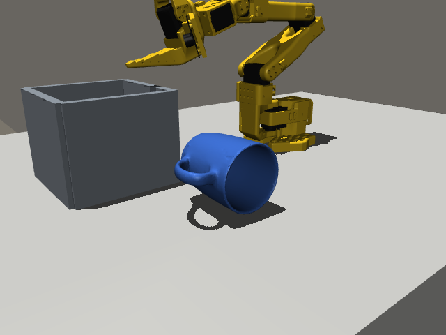
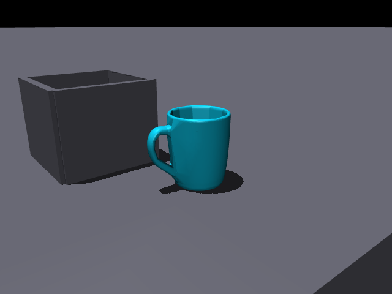

# 47× Too Much Force. Five Passes Flipped. One Dangling Mug.

**Six physics engines, one robot arm, and the weekend our perfect score fell apart — 47× too much grip force, five passes flipped to FAIL, and the gate we built so it can't happen again.**

*Signpost: from zk0, the open-source federated-learning network where independent operators train one shared robot-arm model on private SO-101 data — a sim-research report, for robotics readers and for readers who know zk0's founder from Pirin.ai and Founder Institute alike.*

> **The verdict, up front**
> - MuJoCo won the six-engine scorecard: **82.6/100**.
> - Under the grasp-quality gate, **five PASSes flipped to FAIL**.
> - The wall pinch completed **5/5 tasks**, with slip of **7.3 mm**.

---

## 1. The scorecard: MuJoCo wins, and it isn't close

Six engines, nine criteria, weights fixed in advance (grasp/contact truth at true 1× scale carried 25 of 100 points; inclusivity 15; LeRobot/SO-101 fit 12; gap-closing cost 12; the rest below 12 each). The decisive test was identical for every engine that could run it: pick up a 4 cm, 64 g cube with an SO-101, carry it, place it — verdicts from logged state, never from success flags.

| Engine | Score /100 | Cube test |
|---|---|---|
| **MuJoCo 4.0.1** | **82.6** | PASS 3/3, drift 1.7 mm, placement error 6.3 mm, at stock servo limits (±2.94 N·m) |
| ManiSkill3 (SAPIEN) | 59.0 | PASS 3/3 — but only at 15–20 N·m arm force limits (see §5) |
| Drake 1.58.0 | 58.3 | PASS 3/3, drift 4.8 mm — after heavy asset surgery |
| Genesis 1.4.6 (rigid) | 53.6 | FAIL across ~40 configurations; cube sinks 5–14 mm under gripper load |
| Isaac Sim 5.1 | 50.0 | Never ran the identical test; interpolated from other evidence |
| Genesis 1.4.6 (SAP) | 43.0 | No completed grasp episode exists to score |

ManiSkill and Drake are separated by 0.7 points — a tie for second, not a result. MuJoCo's lead survives the harshest reading of its main confound (its test asset is hand-tuned for grasping): cut its grasp-truth score on that suspicion and it still leads by roughly 16 points, because the margin is built across inclusivity, openness, maturity, and setup, not on one cube.

Engines aren't adopted, though — stacks are. Scoring four complete combinations:

| Stack | Score /100 |
|---|---|
| **A: MuJoCo + Newton USD bridge + free open-licensed object shelf (SimReady Central / YCB / MolmoSpaces) + zk0 spec & probe layer** | **81.6** |
| B: MuJoCo, native MJCF assets only | 75.2 |
| C: Genesis + USD shelf native | 50.6 |
| D: Isaac Sim + native content | 49.2 |

Stack A is what zk0 adopts for the contributor tier. Two of its layers matter for the rest of this story:

- **The object shelf is free and open-licensed** (CC BY 4.0) — nothing to buy. But its physics is *authored, not measured*. NVIDIA's flagship SimReady mug has no authored mass at all; pushed through the bridge it integrates as a solid and weighs **1.5006 kg**, and its collision shape is a single convex hull, which seals the mug's cavity shut. Of every library we audited, only YCB ships *measured* mass. No library anywhere ships measured friction.
- **The zk0 probe layer exists because of that.** Every object that enters our scenes gets spec-vs-measured checks, a drop-and-settle probe, and functional probes (can a ball rest inside the cavity?) before it is allowed to teach or judge anything.

That was the state of play on Saturday night: a clear winner, a 4/4 task battery in MuJoCo, and a founder about to ruin everyone's evening.

So we ran an engine selection the way we think engine selections should be run: identical tasks, state-logged verdicts, frozen scoring criteria, and an independent verifier who re-derived every score from the raw evidence instead of trusting the builder's interim card.

Then our founder watched one of the passing videos, said "that grasp is completely unrealistic," and the whole result set had to be re-earned. This article is the full record — the scores, the failures, the root causes, and the verification machinery we built because of them. The short version: **simulation results are only worth what your verification costs you.**

Nothing in this article claims that success in simulation predicts success on a real arm. The published evidence says sim scores rank policies at best, and can invert against hardware. Everything below is about whether our simulator tells the truth *inside the simulation* — which turns out to be a harder problem than picking the engine.

## 2. Why did one video kill the 4/4?

One of the description-generated scenes (S6b, a kitchen-counter variant) asked for a mug and an apple put into a bin. Our summary reported the mug as "contained ✓ — dead-center in the bin." The founder watched the two-viewpoint video and rejected it on sight: the mug visibly dangled and swung in the gripper; no real grasp looks like that.

He was right, and the forensic investigation that followed is the most useful work in this whole program. We re-ran the scene instrumented at 100 Hz — gripper torque, contact pairs, contact forces, penetration, object pose and slip — and the re-run reproduced the original run exactly, so every number below is the original run's physics.

**Root cause 1: the scorer never looked at the carry.** The scene's success definition checked three things, all at the end of the run: is the mug's final position inside the bin, is it settled, is the arm parked. A mug teleported into the bin would have passed. During the actual carry, the mug hung at **13–52° of tilt** (mean 32°; above 25° in 84% of airborne samples) and **slipped 21.3 mm inside the gripper**. Both quantities were sitting in the run's own state log. Nobody had ever scored them.

**Root cause 2: the gripper was commanded past its own joint range.** The grasp profile ordered a close of −0.65 rad against a joint floor of −0.1745 rad — 0.48 rad past the limit. The position servo therefore pushed at its full ±2.94 N·m stall torque for **100% of the carry**, clamping the mug with a median of **≈70 N of contact force against the mug's 1.48 N weight — roughly 47×**. With that much squeeze, almost any pinch "works."

**Root cause 3 (an amplifier, not the cause): the arm model's fingers are tuned for demos.** The community SO-101 model's gripper contacts run at friction μ = 1.0 with contact priority that *overrides the object's own declared friction class* (the scene said 0.35) at exactly the grasp interface. Counterfactual runs at the scene's friction still lifted the mug — worse, in fact (slip up to 42 mm) — because the clamp force dominates everything. Friction tuning made bad grasps look better; the stall clamp made them possible.

What was *not* wrong: the physics solver, and the mug asset. Penetration never exceeded **1.27 mm**; the contact points lay on the real surface; the pinch was a genuine two-sided pinch. The physics faithfully simulated a gripper squeezing far harder and far more persistently than real hardware sustains — and the one component whose job was to notice never looked.

zk0 is an open-source federated-learning network for robot arms: independent node operators train one shared vision-language-action model (SmolVLA-class) on private SO-101 trajectory data, and only model updates move. For that network to work, validators have to evaluate proposed weights before anyone trusts them — and most of that evaluation has to happen in simulation, on whatever hardware contributors actually own.

## 3. What did the gate change? Five passes flip to FAIL

We wrote the detection fix as a grasp-quality gate, applied per pick cycle. Containment or placement credit now requires **all** of:

| Gate | Threshold |
|---|---|
| Command legality | Gripper command inside the joint range for the whole cycle |
| Tilt | ≤ 15° vs orientation at close, at every airborne sample |
| Slip | ≤ 10 mm in the gripper frame |
| Force band | Median finger force ÷ object weight within 1×–15× |
| Saturation | Gripper at its torque limit ≤ 50% of airborne samples |
| Two-sided contact | Both jaws in ≥ 95% of airborne samples |
| Penetration | ≤ 2 mm |
| Free support | No load-bearing support contact while airborne |

Every previously passing final-state-scored MuJoCo verdict was re-run under the gate (the carry-gated cube acceptance and pen-hold passes were not re-run and stand) (each re-run first reproduced its original verdict under the original scorer, so the deltas are purely the gate's doing):

| Scene / task | Before | Under the gate | What fired |
|---|---|---|---|
| S2 desk sorting | PASS | **FAIL** | All 4 blocks: tilt 41–47°, force ≈138×, saturation 1.000 |
| S3 workshop bench | PASS | **FAIL** | Screwdriver: out-of-range command, tilt 57.2°, force 83.8× |
| Matrix T1 green box | PASS | **FAIL** | Cube: tilt 56.1°, force 135.8×, saturation 1.000 |
| Matrix T2 two buckets | PASS | **FAIL** | Both cubes: tilt ≈39°, force 136–138× |
| Matrix T4 payload → mug | PASS | **FAIL** | Payload: tilt 61.8°, force 324.8× |

**Seven containment credits were revoked** — including one mug that tumbled to 98.4° of tilt and 82.5 mm of slip and still landed in the bin, which the old scorer had counted as contained. The placements were real. The grasps were never good.

The gate also exposed a mechanism nobody had named: **the pivot**. Objects rotate about the jaw contact line mid-carry — a block leaves the table level, tips progressively to ~40° at carry height, then re-levels on descent and lands flat. Origin slip stays around 2 mm the whole time, so every drift-based metric is blind to it by construction. Drift and tilt decouple; if your eval scores only one of them, you have the same blind spot we had.

And a harder truth: the clamp was *universal*. Every carry that night — including the in-range cube profile — ran at the ±2.94 N·m limit for ~100% of airborne samples, because a stiff position servo (kp ≈ 1000) stalling against an object *is* a constant-force clamp. Finger forces ran ≈51× the mug's weight to ≈325× a 25 g payload's. Command legality fixes the worst case; it does not produce a gentle grasp. That needs force-aware closing — a pilot change, not a scorer change. When we re-ran S6b with legal commands only, the mug didn't even make the bin under the *original* scorer: it perched on the rim. There was no working grasp to save.

## 4. Why did the videos lie?

Reviewing the forensic evidence, the founder kept pointing at the same thing: in the videos, the gripper appeared to pass *through* the mug's wall. The numbers said penetration ≤ 1.27 mm. Both observations were correct, because there were **two different mugs in the video**:

- The **collision hulls** the physics actually held: upright, opening up, handle on the side.
- The **visual mesh** the renderer drew: **lying on its side.** The visual file was stored Y-up; the collision hulls were Z-up. Our scene loader assumed both were "already upright" and placed them with the same rotation — so the gripper closed on an upright mug the camera couldn't see, while a sideways mug's walls swept through the fingers on screen.

A scene-assembly bug in our own loader, not a solver failure — and it had been in every video of that mug we had ever shown anyone. The fix produced the strangest artifact of the weekend: a side-by-side render of the *same run* (verified identical — final position matched to four decimals across replays), visual view on the left, collision view on the right. On the right, the orange jaw shapes rest on the cyan hull surface in a clean pinch, nothing passes through anything, and the mug visibly pivots and hangs — the real failure, finally visible as itself.

<video controls preload="metadata" src="/docs/images/s6b-sidebyside-close.mp4" style="max-width: 100%; height: auto;"></video>
*The same run, two views: what the camera drew (left) vs what the physics held (right).*

*The same mug at rest — the visual mesh (left, sideways) vs the collision shape (right, upright).*

Two standing rules came out of this:

1. **Every imported or generated object now passes a visual-vs-collision alignment check** before it can appear in evidence. A render can lie even when the physics and the state logs are true.
2. **All visual-view evidence from the affected runs is withdrawn.** State-logged verdicts stand; anything judged by eye from those videos gets re-read.

## 5. Two asterisks get resolved — one in each direction

**ManiSkill's pass was force-bought.** Its cube-test pass required arm force limits of 15–20 N·m. We re-ran the identical test at the URDF's own 10 N·m limit and at the real STS3215 servo class, 2.94 N·m. It fails at both — on drift only: **11.74 mm** against the 10 mm bar at 10 N·m, **10.80 mm** at 2.94 N·m (a margin of about 0.8 mm — approximate; each series is one deterministic execution reproduced three times, so read it as n=1, not n=3). The four-task battery at 10 N·m drops to 3/4. ManiSkill keeps its #2 tie on the scorecard's breadth criteria, but it is not eligible as an eval gate, and now that's measured rather than assumed. An honest detail in the other direction: inside the failing range (10 → 2.94 N·m), drift *shrinks* as force drops (11.74 → 10.80 mm — the weaker arm moves more gently and slips the cube less, though the gripper limit drops alongside the arm limit there, so the trend isn't arm force alone) while placement error grows. Across the full ladder it runs the other way: 15 N·m passes at 7.15 mm of drift. Reality is rarely a straight line down.

**The arm model itself is demo-tuned.** Community fits of this exact servo put the simulated unit at roughly 100× the stiffness of the real STS3215, with no heat or current limit modelled — peak stall torque, sustained forever. So we built **`so101-realistic`**, a variant of the community model with exactly two physics changes: the gripper contact class de-tuned to the forensic values (μ 1.0 → the 0.35 class, contact dimensionality 6 → 3, priority override removed, so the object's declared friction governs), and an elbow joint limit corrected to a community fix (1.69 → 1.474 rad). We pre-registered the expectation — *under the variant, the stall-clamp lift fails or degrades* — and the result was **half-met, and we published it that way**: degradation confirmed (tilt 84.8°, slip 42.0 mm in the replay, vs 59.0° / 21.5 mm on stock), but the lift does not fail. That is the correct scientific outcome and it sharpened the causal story: contact tuning is the amplifier; the sustained stall clamp is the enabler; only a servo-behaviour model (the BAM wrapper tier, future work) addresses the enabler.

## 6. What grasp beat both of ours?

Every mug grasp in the program had used a body-span pinch: fingers on opposite outer walls. The measured numbers explain why that struggles — the YCB mug's body is **Ø 93.1 mm** (measured from the mesh; an earlier ~80 × 82 mm figure in our own audit was wrong and is withdrawn), the gripper's measured fingertip opening is **97.7 mm**, so the grasp is fingertip-only, with no wrap. The YCB mug is also the collection's anchor asset precisely because its mass is *measured*: **118 g**, where the shelf's authored equivalents integrate to 1.25–1.5 kg.

The founder proposed the obvious-in-retrospect alternative: a **wall pinch** — one finger inside the cavity, one outside, clamping the ~4.4 mm wall itself. We tested it on the YCB mug under the gate, legal commands only:

| Metric (gate limit) | Body-span | Wall pinch |
|---|---|---|
| Original scorer | Not contained | **PASS, 5/5 runs** (incl. ±5 mm aim error) |
| Slip (≤ 10 mm) | 37.6 mm ✗ | **7.3 mm ✓** |
| Saturation (≤ 50%) | 1.000 ✗ | **0.000 ✓** |
| Force, median (≤ 15×) | 61.2× ✗ | 19.1× ✗ — 3.2× lower than the body-span baseline |
| Tilt (≤ 15°) | 52.5° ✗ | Peak 61.4° ✗ (median 28.5°) |
| Two-sided contact (≥ 95%) | 0.971 ✓ | 1.000 ✓ |
| Penetration (≤ 2 mm) | ≤ 1.71 mm ✓ | 0.54 mm ✓ |

<video controls preload="metadata" src="/docs/images/wall-pinch-run1-close.mp4" style="max-width: 100%; height: auto;"></video>
*The wall pinch, close view: one finger inside the cavity, one outside, clamping the wall itself.*

The wall pinch completes the task in every run, never stalls the servo, and eliminates the entire clamp failure family. It still fails the gate — on tilt, for a *different reason* than the body-span: the mug hangs from a single wall-clamp point and rotates progressively under gravity (tilt starts near level at lift-off and grows; it is above the 15° limit in 79% of airborne samples, peaking at 61.4° late in the carry). The short inside finger offers no second contact to arrest the rotation, and raising the grip to the rim didn't help (63.1°). What's left is a one-contact-point geometry problem, not a force problem — and that reframing is what a good test is for. Whether a rim-hook or longer-finger variant can arrest the hang is untested, and we say so rather than guessing.

## 7. The machinery that outlives the result

The engine choice will age. The verification discipline is the actual deliverable, and it is now how zk0 runs:

- **Independent verification, structurally.** The agent that builds a test never certifies it. A verifier in a separate context gets the raw artifacts and the acceptance criteria — never the builder's conclusions — and its corrections are what get published. Both audits this weekend caught real errors in the builders' language (a peak tilt reported as a throughout-carry value; a miss distance quoted on one axis instead of radially). That's the system working, and the corrections are in the public record, not quietly edited away.
- **Sealed claims.** A claim verified against a recorded set of inputs — files, parameters, thresholds, the verification code itself — is stamped and reused without re-verification. Change any input that matters and the seal breaks and the claim is re-earned. Whether a change matters is a judgment call, and it belongs to a third role: an auditor who is neither builder nor verifier.
- **The asset collection.** Objects enter the zk0 collection only through the probe battery, with provenance marks that are never blurred: measured vs estimated physics, sim-trained / sim-validated / real-validated, and a signed seal bound to the exact file hashes (the generated mug's seal is issued; the YCB mug's and the arm variant's are staged, not yet issued). Scene builders consume only from the collection — never from a scratch folder. (The sideways mug reached our scenes precisely because a loader grabbed a pre-fix file from a scratch directory. The corrected file existed the whole time.)
- **Licence split, industry-standard:** code and model weights Apache-2.0; assets CC BY 4.0, whether we create them or rehabilitate them from the free open-licensed object shelf.

## 8. What we'd tell anyone building sim evals for SO-101-class arms

1. **Score the carry, not the landing.** Final-position success definitions will manufacture passes. Tilt and slip are computable from logs you probably already record.
2. **Drift is not orientation.** An object rotating about its own origin tilts freely at ~0 drift. Gate both, or gate neither and know it.
3. **Check your commands against your joint ranges.** One out-of-range close turned a torque-capped servo into a 47× clamp for an entire program of experiments.
4. **Your arm model is a claim, not a fact.** Community models are tuned so demos look good: sticky fingers with priority overrides, servos ~100× too stiff, stall torque sustained indefinitely. Measure the limiting quantities yourself — we measured our gripper's opening (97.7 mm) only after a wrong diagnosis ("the mug is beyond its envelope") had already been written into a report.
5. **Treat every asset's physics as unproven until probed.** Authored mass can be off by an order of magnitude (1.5 kg for a coffee mug); a single convex hull seals every cavity; *no* library ships measured friction.
6. **Verify the render against the physics.** If your visual mesh and your collision shape disagree by 90°, your videos are fiction and your reviewers are reviewing fiction.
7. **Distrust success flags; log state.** In this program, built-in success terminations fired on runs that flung the object across the scene. Every verdict we still stand behind came from logged state.
8. **Pre-register your expectations, and publish the half-met ones.** The arm-variant test that "failed to fail" taught us more than the confirmations did.

## Evidence

All runs state-logged; every scored run has two-viewpoint video rendered from the same run that produced its state log. Working reports (local research notes, mirrored to the zk0 Drive SSOT): *zk0-sim-scorecard-final-20261115*, *zk0-s6b-forensics-20261116*, *zk0-gated-rescore-20261116*, *zk0-s6b-collision-render-20261116*, *zk0-sim-assets-publish-20261116*, *zk0-wall-pinch-test-20261116* (+ verifier audit), *zk0-maniskill-force-rerun-20261116* (+ verifier audit).

Code: [github.com/ivelin/zk0](https://github.com/ivelin/zk0) (Apache-2.0). The asset collection — **"zk0 Simulation Assets"** on Hugging Face, including `so101-realistic`, the measured YCB mug package, and the sealed generated mug — is live: [huggingface.co/collections/zk0bot/zk0-simulation-assets](https://huggingface.co/collections/zk0bot/zk0-simulation-assets).

## Get involved

zk0's bottleneck is not compute — it's verified evaluation and diverse, honest data.

- **Run a node.** If you have an SO-101 and a GPU box, you can train on data that never leaves your disk and contribute updates to one shared model.
- **Contribute an object.** Capture a household object with the ~$15–20 kit (kitchen scale, printed friction card, calibration cube, phone photogrammetry), run the probe battery, and publish it to the collection with its provenance marks. Every sealed object makes every validator faster.
- **Try to break our gate.** The grasp-quality gate, the scorecard, and the audits are public. If you find a carry that passes the gate and shouldn't — or one that fails and shouldn't — that's a contribution too.

Simulation results are only worth what your verification costs you. Ours cost us a weekend, five retracted passes, and one sideways mug. Worth it.

*— The zk0 team, 2026-11-16*

